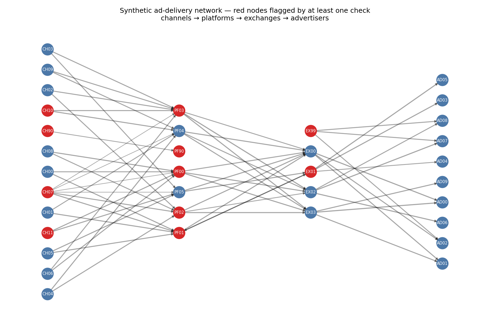

# Anomaly Detection in an Ad-Delivery Network (NetworkX)

A small project showing graph-based data-quality checks on a synthetic streaming ad-supply chain:
**channels → platforms → exchanges → advertisers**. Edge weight = impressions.

## Why a graph?
Impressions should flow one way through the chain and be roughly conserved at each intermediary.
Many data-quality problems are structural, so they are easier to catch as graph properties than as row-level rules.

## Pipeline
1. **Generate** a 35-node, 64-edge network where each intermediary passes on 93-100% of what it receives.
2. **Inject** six known anomalies (ground truth, saved to `ground_truth.json`).
3. **Validate records**: self-loops, NaN and negative values. Drop bad edges before analysis.
4. **Graph checks** on the cleaned graph:
   - backward edges and cycles (`nx.simple_cycles`)
   - orphan sources and dead ends (in/out degree by layer)
   - disconnected islands (`nx.weakly_connected_components`)
   - flow conservation (out/in ratio outside 0.90-1.02)
   - per-layer degree outliers (median + 3 × scaled MAD)
5. **Evaluate** findings against the injected ground truth.



## Results (seed 42)
| Injected anomaly | Caught by |
|---|---|
| Inflated flow (PF03 reports 1.8x what it received) | flow_imbalance (ratio 1.76) |
| Reseller loop (PF01 ↔ EX01) | backward_edge, cycle |
| Ghost exchange (EX99 has no inbound traffic) | orphan_source |
| Bad records (self-loop, negative, NaN) | invalid_record |
| Disconnected island (CH90 → PF90) | island, dead_end, flow_imbalance |
| Traffic spray (CH07 linked to every platform) | degree_outlier |

6/6 injected anomalies detected, 0 findings unrelated to an injected anomaly.

## Limitations (be honest about these)
- **Synthetic data, one seed.** Perfect recall here says the checks work as designed, not that they generalise. Next step: sweep seeds and noise levels and report precision/recall.
- **Node-level scoring is loose.** An anomaly counts as detected if any finding touches one of its nodes. Because the negative-value edge happens to target PF01, `invalid_record` also shows up under the cycle anomaly. Edge-level scoring would be stricter.
- **Fixed thresholds.** The 0.90-1.02 flow band and the degree rule are hand-set. A real dataset would need thresholds learned from history.
- **`simple_cycles` can blow up** on large dense graphs; use SCC-based detection at scale.

## Ideas to extend
- Weighted centrality (PageRank, betweenness) as a fraud-hub signal
- Root-cause tracing: walk upstream from a flow-imbalance node to find where the extra impressions entered
- Rerun the checks in Snowflake/Databricks (SQL or Spark GraphFrames) on a larger synthetic graph

## Run
```
pip install -r requirements.txt
python netanomaly.py
```
Outputs: `findings.csv`, `ground_truth.json`, `network.png`.
